<div align="center">


# Shiftella

**Shift planning, clock-in and timesheets for small teams — on the web, Android and iPhone.**

[shiftella.app](https://shiftella.app) · [Roadmap](ROADMAP.md) · [Deploy docs](deploy/hetzner/README.md) · [Billing docs](docs/billing.md)

[](https://github.com/NnnotAnwar/shiftella-app/actions/workflows/ci.yml)
[](https://github.com/NnnotAnwar/shiftella-app/actions/workflows/deploy-hetzner.yml)


<br />

<picture>
  <source media="(prefers-color-scheme: dark)" srcset="docs/images/hero-dark.png" />
  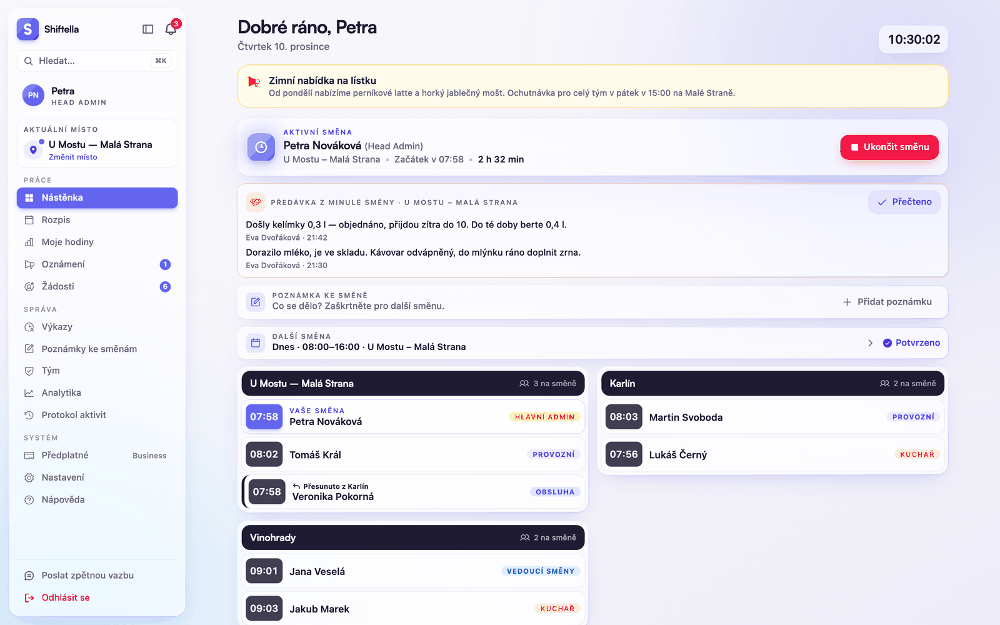
</picture>

<br /><br />

<picture><source media="(prefers-color-scheme: dark)" srcset="docs/images/phone-home-dark.png" />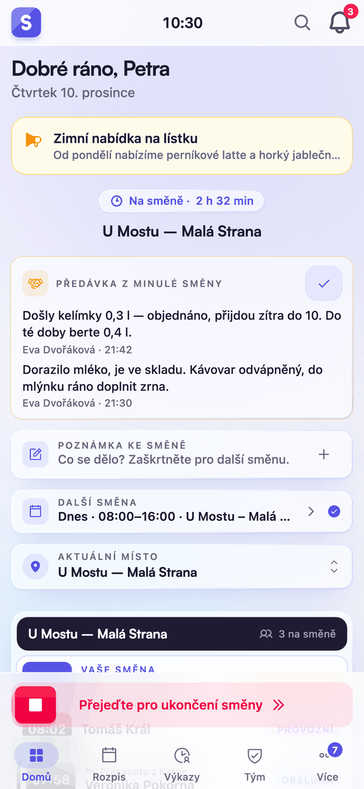</picture>
&nbsp;
<picture><source media="(prefers-color-scheme: dark)" srcset="docs/images/phone-schedule-dark.png" />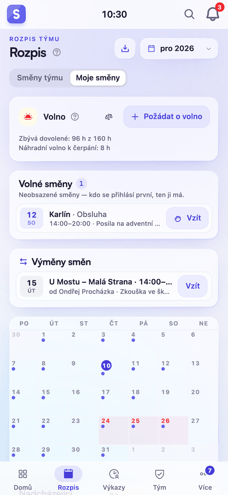</picture>
&nbsp;
<picture><source media="(prefers-color-scheme: dark)" srcset="docs/images/phone-more-dark.png" />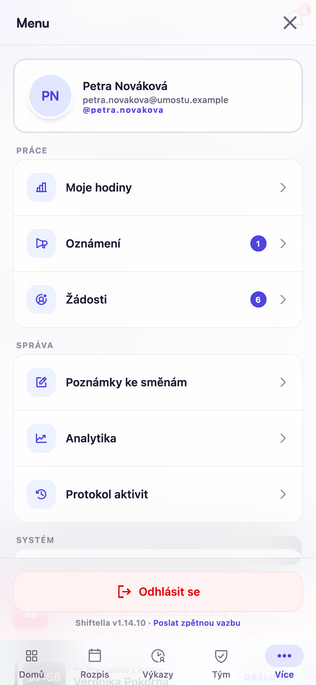</picture>

<sub>Czech UI · demo data (an invented Prague café) — no real people.</sub>

</div>

---

## 👋 About

Shiftella is a shift-management app built for small and mid-sized teams — cafés,
shops, clinics, warehouses — that still plan their week in Excel and a group chat.
The owner creates an organization in a minute; staff clock in on their phone, see
their shifts, swap them and ask for time off; managers build the month's rota on a
paper-like grid and publish it with one tap. Everything a team does lands in one
place, in Czech or English, on the web or as a native app.

It is a complete product, not a demo: real sign-up and invites, custom roles
enforced in the database, an activity log of every action, push notifications,
Czech labour-law checks and paid plans with Stripe — designed, built, tested and
operated end to end by one developer.

---

## 🧭 Product tour

<table>
<tr>
<td width="50%" valign="top">

### Live board
Who is on shift right now, per location, updating in real time. Your own shift,
the next one and a team announcement sit on top; one tap starts or ends a shift.

</td>
<td width="50%">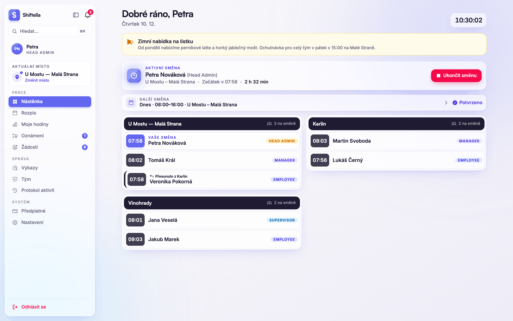</td>
</tr>
<tr>
<td width="50%">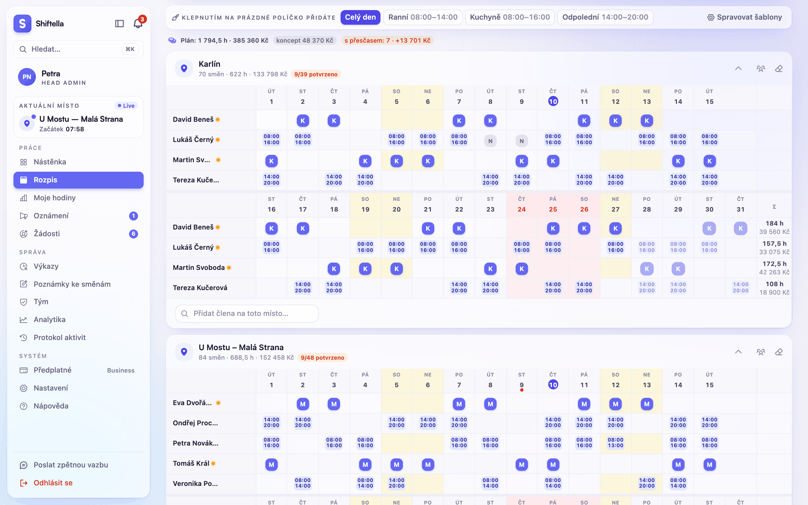</td>
<td width="50%" valign="top">

### Rota on a paper-like grid
People × days, location letters in the cells, Σ hours per person. Paint shifts
from templates, copy last month, keep it a draft and publish when ready — staff get
a push. The grid warns about less than 11 h of rest, a 7th day in a row, holidays
and time off.

</td>
</tr>
<tr>
<td width="50%" valign="top">

### My hours
Worked vs. planned shifts this month, a pace chart against last month, totals with
the Czech mandatory-break rule built in, and a pay estimate from the hourly rate.
Exports to PDF, Excel and CSV for payroll.

</td>
<td width="50%">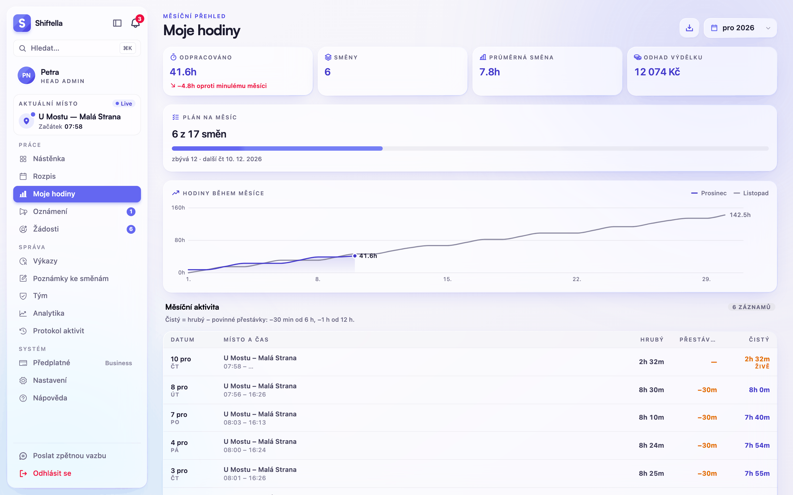</td>
</tr>
<tr>
<td width="50%">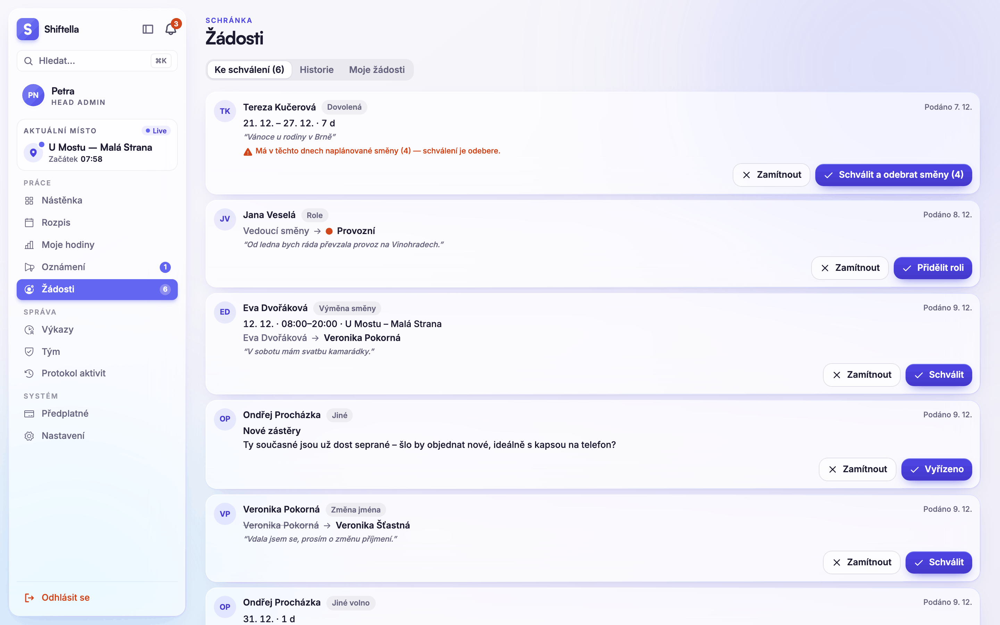</td>
<td width="50%" valign="top">

### One inbox for requests
Time off, shift swaps, role requests, name changes and complaints (optionally
anonymous). Four-eyes by design: nobody decides their own request — not even the
owner — and approving leave clears the rota for those days.

</td>
</tr>
<tr>
<td width="50%" valign="top">

### Plans & billing
**Free during the beta** — every organization gets Business, no limits, no card.
After the beta: Free, Team and Business with a 30-day trial. Checkout and invoices
run on Stripe; switching plan, interval or back to Free happens right in the app,
with the exact price and seat count shown before anything is charged.

</td>
<td width="50%">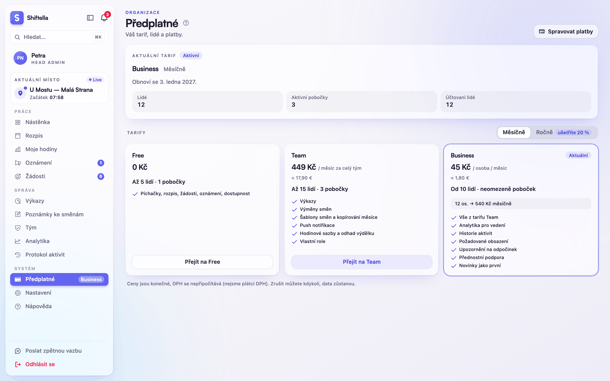</td>
</tr>
<tr>
<td width="50%">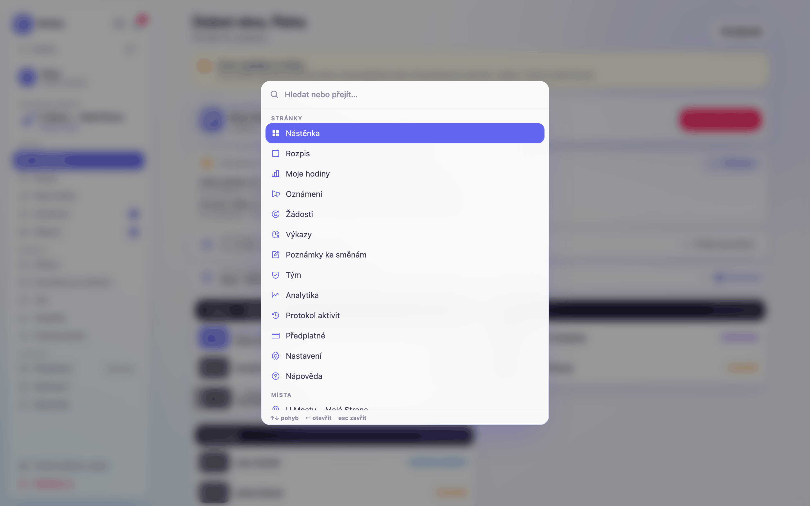</td>
<td width="50%" valign="top">

### Fast to get around
A command palette (⌘K) jumps to any page or location; the sidebar, a role-aware
mobile tab bar and one-tap actions with Undo keep frequent work to a single tap.

</td>
</tr>
</table>

---

## ✨ What's inside

| | |
| --- | --- |
| ⏱ **Clock in / out** | By location, live board of who's on shift (Realtime), auto-end at midnight |
| 🗓 **Rota** | Roster grid + month calendar, templates, copy month, draft → publish, open shifts, swaps |
| 🇨🇿 **Czech rules** | 11 h rest, max 6 days in a row, mandatory breaks, public holidays |
| 📥 **Requests** | Time off, swaps, role requests, complaints (optionally anonymous), four-eyes decisions |
| 📊 **Timesheets** | My hours with month pace, team timesheets, PDF / Excel / CSV exports, wages & pay estimate |
| 🛡 **Roles** | Discord-style custom roles: view / change / delete per area, hierarchy enforced in Postgres RLS |
| 📣 **Communication** | Announcements, in-app bell, push notifications (FCM) with per-category preferences |
| 💳 **Subscriptions** | **Free beta now** (Business for everyone). After it: Free · Team (449 Kč flat) · Business (45 Kč / person), 30-day trial, Stripe Checkout & Portal, in-app plan changes |
| 📜 **Activity log** | An append-only record of every action, filterable by person and group |
| 🌍 **Everywhere** | Web (PWA), Android & iOS (Capacitor), Czech / English, light & dark, five colour schemes |

<details>
<summary><b>All features in detail</b></summary>


### Shift tracking
- **Clock in / out by location**, with mid-shift location switching and a
  confirm/switch popup.
- **Live board** — see who's on shift right now, updating instantly via Supabase
  Realtime (with automatic reconnect). The board shows only locations with
  activity, so it scales with the team, not the location count.
- **Auto-end at midnight** — shifts left open overnight are closed automatically
  at Europe/Prague midnight by a scheduled job.

### Scheduling (rota)
- **Two views of one rota:** a **roster grid** (people × days, paper-rota style —
  the default) split into 1–15 / 16–end print bands, and a **month calendar per
  location**. Admins tap a cell (grid) or a day (calendar) to assign staff.
- **Day editor** — assign several people at once, per-member times or an all-day
  mark; anyone already busy elsewhere that day is locked, and the database
  rejects overlapping assignments so nobody is double-booked.
- **Planning tools:** per-location **staff rosters**, restaurant **short/long-week
  quick-fill** (replaces, doesn't stack), clear a person / location / whole month,
  **copy last month**, **My Team** self-service (take & release members), person
  search, admin-set **location letters** shown in cells, and a Σ hours column.
- **Draft → publish** — new assignments are drafts only the planner sees; one
  **Publish** flips the month live for members and notifies everyone involved.
- **Time off** (vacation / sick / other): members request, admins approve or
  decline in Requests (or enter pre-approved leave); approved leave **clears the
  rota** for those days and blocks planning, and overlapping leave per person is
  rejected.
- **Reminders:** if someone hasn't clocked in, **late-for-shift alerts** fire at
  +15 min and +1 h to the member and their manager (pg_cron, every 5 min).
- **Exports mirror the on-screen view** — the grid exports as a people × days
  matrix (PDF in two print bands / Excel), the calendar as month pages.
- A **next-shift card** on the dashboard, and today's rostered location
  preselects your clock-in.
- **Fast grid editing** — pick a template in the brush bar and tap empty cells to
  paint shifts; tap an existing shift to remove it, with **Undo** in the toast.
- **Shift templates** — save a time once ("09:00–17:30") and reuse it in the grid
  and the day editor; up to 8 per organization.
- **Shift confirmations** — members tick their upcoming shifts (select all →
  Confirm). A confirmation is final for the member and resets automatically when
  an admin changes that shift.
- **Availability** — members mark days they can't work; the grid hatches them and
  the editor warns before you plan someone there.
- **Coverage targets** — set how many people a location needs per weekday; days
  below target get a dot in the grid.
- **Open shifts** — post an unassigned shift; members claim it (or give it back);
  an admin adds it to the rota in one tap.
- **Czech public holidays** are marked in the rota. Working on a holiday is
  allowed; the app warns once (with "don't show again").
- **Location opening hours** — a location's hours are its default shift: the
  location letter in the grid means "the whole opening time", and planning
  outside the hours is flagged.
- **Rest rules (Czech labour law)** — the grid warns when someone gets less than
  11 h between two shifts or works more than 6 days in a row.
- **Shift swaps** — a member offers an upcoming shift (to anyone or one
  colleague), a teammate who is free takes it, and someone with the right to
  decide approves it in Requests; the shift then moves to the taker.

### Timesheets & analytics
- **My hours** (Overview, per member): this month's plan (worked vs. planned
  shifts), an hours-through-the-month chart with last month for comparison,
  totals and averages, with **mandatory-break math** baked in (−30 min for every
  started 6 h, per Czech labour law).
- **Timesheets**: managers view a member's month; admins also add, edit and
  delete shifts, with an overnight-shift-aware time picker.
- **Exports** as **PDF / Excel / CSV**, per employee or the whole team; on native
  they open the OS **share sheet**, on web they download.
- **Activity Log**: an append-only record of **every action** in the app —
  clock-ins and -outs, the rota, requests and decisions, swaps, announcements,
  open shifts, templates, availability, wages (who changed whose rate, never the
  amount), locations and their hours, roles and permissions, invites and
  removals. Filter by person or by group (Shifts, Rota, Requests, Team, Roles,
  Announcements, Locations).
- Months are bucketed by the viewer's **local** calendar month (no UTC-boundary
  surprises).

### Sign-up & admin
- **Owner sign-up** — anyone can create an account (email + password) together
  with a brand-new organization and becomes its Head Admin. Invited members
  still join an existing organization through their invite.
- **Admin Panel** for Organizations (Superadmin), Locations and Team: create /
  edit / delete, with search. An empty organization can be deleted.
- **Hourly wages** are set by people with the Wages right (for people below
  them, never themselves) and feed a pay estimate.
- **Invite by email, with a role** — new members are provisioned into the right
  organization and role atomically, finishing onboarding on a branded
  `/accept-invite` page.

### Custom roles (Discord-style)
- **Roles your way** — the Head Admin creates roles with any name and colour and
  ticks **view / change / delete** per area: rota, timesheets, requests,
  announcements, team, wages, locations, activity log and roles.
- **The order is the hierarchy** — move roles up and down; you manage only people
  and roles below your own, and can hand out only the rights you hold yourself.
- **Presets to start from** (Employee, Supervisor, Manager, Admin, Head Admin) —
  editable, or used as a template for a new role. Head Admin always stays on top
  with every right.
- **A default role for everyone** — "Employee" sits at the bottom and its rights
  add to every member's own role. Deleting a role moves its people there.
- Everything is enforced in the database (RLS, triggers, checked RPCs), not just
  the UI.

### Requests
- **One inbox for every request** — time off (vacation / sick / other), name
  changes, shift swaps, **role requests**, any **other request**, and
  **complaints**, with *To review*, *History* and *My requests* tabs.
- **New request** form: ask for a role (approving applies it at once — only
  someone allowed to give that role can), write any other request, or file a
  complaint, **optionally anonymous** (reviewers never see the sender; the
  activity log and pushes don't either).
- **Four eyes**: approve, or decline with a reason the member sees. Nobody
  decides on their own request — not even the Head Admin; your own pending
  requests show in the queue without buttons. Approving leave warns first when it
  would remove planned shifts. People with view-only access see the queue
  read-only; complaints only reach those who can decide them.
- Members track every decision and can withdraw a pending request. **Username**
  is self-service but rate-limited to once every 7 days.

### Announcements
- Admins post, pin, edit and delete notices for the whole team. New posts arrive
  as a push notification and an unread badge; the latest unread one shows on
  Home.

### Notifications
- **In-app bell** — a personal feed of what concerns you: your schedule being
  published / changed / removed, time-off and request decisions, swaps, new
  requests to review, late-shift alerts, name-change decisions, announcements,
  and edits to your profile or role.
- **Push notifications** (Firebase Cloud Messaging, native): the same events,
  delivered to your device, with **per-category preferences** (master switch +
  shift / account / requests) in Settings. Tapping opens the relevant screen —
  or the notifications panel when there's no dedicated one.
- Everything also lands in the **Activity Log** for people with that right.

### Navigation
- **Command palette** (**⌘K / Ctrl K**) to jump to any page or location.
- Sticky, collapsible sidebar grouped by section + a searchable location picker
  with recent posts.
- **Role-aware mobile tab bar** — staff get Home · Schedule · My hours ·
  Announcements · More; managers and admins get Home · Schedule · Timesheets ·
  Team · More.

### Localization & theming
- **English / Čeština** throughout, with a 12h/24h time-format option and
  locale-aware dates.
- **Premium glass design** — frosted surfaces, compact type, one consistent set of
  components on every page.
- **Colour schemes** (Lilac / Emerald / Cyan / Amber / Violet) + **Light / Dark /
  System** themes, with native status-bar sync.

### Mobile (Capacitor)
- Native-style bottom tab bar + a "More" control center (grouped nav, quick
  theme/language, app version).
- **Pull-to-refresh**, **haptics**, **skeleton** loading states, and the Android
  **hardware back button** dismisses open overlays before navigating.
- Safe-area handling, splash/keyboard/status-bar plugins, native share, and
  push notifications.
- **PWA-ready** — installable from the browser (Add to Home Screen).

### Subscriptions & billing
- **Free beta (now)** — one database switch (`app_settings.free_beta`) gives
  every organization Business with no limits; nothing can be bought (checkout
  refuses on the server), the app shows "Free beta" instead of prices. Ending it
  is a fresh trial for everyone plus one flag — see
  [docs/free-beta.md](docs/free-beta.md).
- **Plans** (after the beta) — Free (up to 5 people, 1 location), **Team** (flat 449 Kč / month,
  up to 15 people and 3 locations), **Business** (45 Kč per person / month,
  from 10, unlimited). Yearly billing saves 20 %. Prices are final (no VAT added).
- **30-day Business trial** for every new organization, no card. When it (or a
  paid subscription) ends, the owner gets a one-time prompt to pick a plan; the
  organization falls back to Free and nothing is deleted.
- **Stripe** Checkout for new subscriptions; plan and interval changes happen in
  the app with the right seat count (Team 1, Business = people, min 10); the
  Customer Portal handles cards, invoices and cancelling. Switch to Free cancels
  at the period end, with a one-tap resume.
- **Limits enforced in the database**; the platform owner can grant any
  organization a plan for free. See [docs/billing.md](docs/billing.md).

</details>

---

## 🧪 Engineering highlights

- **Security in the database, not the UI.** Organization isolation, the role
  hierarchy, "hand out only rights you hold", four-eyes decisions and plan limits
  are enforced with Postgres **RLS policies, triggers and checked RPCs** — they
  hold for direct API calls too. An RLS smoke test proves it on every release.
- **Real-time by default.** Supabase Realtime drives the live board, requests
  and the bell, with reconnect handling and React Query cache updates instead of
  refetch storms.
- **Billing that can't drift.** Stripe is the source of truth; a signed webhook
  mirrors subscriptions, seat counts follow the team automatically (prorated
  monthly, invoiced at once on yearly plans) and plan changes go through the app
  so a portal switch can never carry the wrong quantity.
- **Audit everything.** Every action — clock-ins, rota edits, decisions, role and
  wage changes (never the amounts), invites, plan changes — writes to an
  append-only activity log, which also feeds the localized push notifications.
- **Reproducible screenshots.** The README images come from a harness that runs
  the real app against an in-memory fake Supabase with invented data and a pinned
  clock — no real people, no backend.
- **Boring, safe operations.** Static SPA on a Hetzner server behind a shared edge
  Caddy; CI builds, ships a tarball over a forced-command SSH key and switches an
  atomic symlink — rollback in seconds. 250+ unit tests, lint, type-check and
  Caddy validation on every PR.

---

## 🛠 Tech stack

| Layer | Tech |
| --- | --- |
| Frontend | React 19 + TypeScript, Vite 7 |
| Routing / state | React Router 7, TanStack Query 5 |
| Styling / motion | Tailwind CSS v4, Framer Motion, Phosphor icons |
| i18n | Custom lightweight `t()` + EN/CS dictionaries |
| Validation | Zod |
| Reports | jsPDF + jspdf-autotable, SheetJS (xlsx, lazy-loaded) |
| Backend | Supabase — Postgres, Auth, Realtime, Edge Functions, pg_cron |
| Native | Capacitor 8 (Android & iOS) — push, share, filesystem, haptics, keyboard, splash, status-bar |
| Tooling | ESLint 9, Prettier, Vitest, Yarn 4 (Corepack) |

---

## 🧱 Architecture

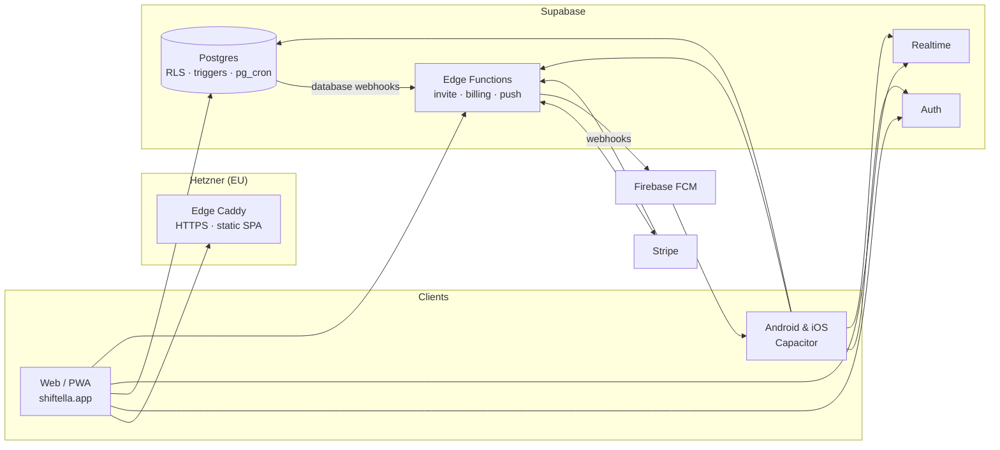


```
src/
├─ app/            # shell, layout (AppShell, Sidebar, BottomNav), command palette,
│                  # navigation config, providers, router guards
├─ features/
│  ├─ auth/        # login, accept-invite, AuthContext, route guards
│  ├─ shifts/      # clock in/out, realtime, Overview + export
│  ├─ schedule/    # rota: roster grid + calendar, day editor, time off, exports
│  ├─ locations/   # location picker (recent + search), confirm/switch popup
│  ├─ timesheets/  # admin shift management, exports, Activity Log
│  ├─ admin/       # Admin Panel: orgs / locations / team
│  ├─ roles/       # custom roles: list + hierarchy, editor, permission matrix
│  ├─ requests/    # Requests inbox: time off, names, swaps, role/other/complaints
│  ├─ announcements/# team announcements, read state, home banner
│  ├─ availability/# "can't work" days
│  ├─ wages/       # hourly rates (admin-only) + pay estimate
│  ├─ notifications/# in-app bell + push registration + preferences
│  ├─ profile/     # profile editing
│  └─ settings/    # appearance, language, time format, notifications
└─ shared/         # api client, types (zod), i18n, UI components, hooks, utils
supabase/
├─ migrations/     # SQL schema, RLS policies, triggers, cron
├─ functions/      # Edge Functions (Deno)
└─ tests/          # rls_smoke.sql — org isolation + request rules (rolled back)
```

### Roles & permissions

Each organization has its own **roles** (`org_roles`), ordered top to bottom:
the order is the hierarchy (Head Admin is always 40 at the top, the default
Employee role always 0 at the bottom). A role carries **view / change / delete**
per area (`org_role_permissions`). A member's rights are their own role's plus
the default role's; Head Admin and Superadmin hold everything.

| Preset | Starts with |
| --- | --- |
| Head Admin | Everything, incl. roles and locations (locked) |
| Admin | Change rota, timesheets, requests, announcements, team, wages; view locations + activity |
| Manager | View rota, timesheets, requests, team, announcements |
| Supervisor | Nothing beyond the default role |
| Employee (default) | Own shifts, own requests, clock in/out — its rights add to everyone's |

The UI asks for a **capability** (`can(user, 'rota.edit')` in
`src/shared/auth/permissions.ts`, read from the role's matrix); the database
enforces the same rule with `has_permission(area, action)` in **RLS policies,
triggers and checked RPCs**, so it holds even for direct API calls. Managing
only people and roles below your own, handing out only rights you hold, no
self-escalation, four-eyes request decisions and org scoping are enforced the
same way.

### Edge Functions (`supabase/functions/`)
- **`invite-employee`** — invites a user and provisions org + (custom) role;
  logs who invited whom.
- **`delete-employee`** — removes a member with permission + hierarchy checks;
  logged.
- **`username-login`** — resolves a username to an email for sign-in.
- **`delete-account`** — GDPR self-service account deletion; the organization
  keeps a log entry.
- **`billing-checkout`**, **`billing-change-plan`**, **`billing-portal`** —
  Stripe Checkout, in-app plan / interval changes (incl. switch to Free and
  resume) and the Customer Portal; only the organization's owner.
- **`stripe-webhook`** — verifies Stripe's signature and mirrors subscriptions
  into `public.subscriptions`; keeps the Business seat count in step.
- **`send-push`** — sends FCM (HTTP v1) pushes from Database Webhooks
  (`shift_audit_log`, `name_change_requests`, `announcements`), localized per
  recipient (EN/CS) and honouring per-user preferences. Schedule and time-off
  notifications flow through the `shift_audit_log` webhook (rows are written by
  SECURITY DEFINER triggers / the publish RPC).

---

## 📦 Getting started

Needs **Node 22** (`.nvmrc`; CI and deploys use 22). Uses **Yarn (Berry v4, via
Corepack)** — single lockfile (`yarn.lock`); version pinned in `package.json`
(`packageManager`). Don't add `package-lock.json`.

```bash
nvm use                  # or any Node 22
corepack enable          # once
yarn install
cp .env.example .env      # then fill in the values below
yarn dev                 # Vite dev server, exposed on your LAN (--host)
```

### Environment variables
| Variable | Description |
| --- | --- |
| `VITE_SUPABASE_URL` | Supabase project URL, e.g. `https://<ref>.supabase.co` |
| `VITE_SUPABASE_PUBLISHABLE_KEY` | Supabase publishable (anon) key. **Never** ship the `service_role` key to the client. |

The displayed app version is injected from `package.json` at build time.

### Local Supabase
Needs Docker and the Supabase CLI **3.x** (`supabase --version`; `supabase/config.toml` uses the 3.x keys).
```bash
supabase start            # boot local stack (Docker); applies every migration + supabase/seed.sql
supabase db reset         # start over: migrations + seed again
supabase functions serve  # run Edge Functions locally
```
- Lighter stack when you only need the DB + API: `supabase start -x studio,logflare,vector,imgproxy,realtime,storage-api,edge-runtime,mailpit,postgres-meta,supavisor`.
- "port is already allocated" on 54321–54327: an old stack from before the rename (project id `planuj-smeny-app`) is still running — `supabase stop --project-id planuj-smeny-app`.
- Never `supabase db push` to the hosted projects: their migration history differs (apply migrations to preprod with the MCP `apply_migration`).

### Build for native
```bash
yarn build
npx cap sync
npx cap open android   # or: npx cap open ios
```

### Push notifications (native)
Push requires Firebase (FCM). In short: create a Firebase project, add the
Android app (`com.shiftella.app`), drop `google-services.json` into
`android/app/` (gitignored), then deploy the function and wire the webhooks:
```bash
supabase secrets set FCM_SERVICE_ACCOUNT="$(cat service-account.json)"
supabase functions deploy send-push --no-verify-jwt
```
Create Database Webhooks (INSERT) on `shift_audit_log`, `name_change_requests`
and `announcements` pointing at the `send-push` function. Keep the Firebase
**service-account key out of git** (it's ignored).

---

## 🧰 Scripts
| Script | What it does |
| --- | --- |
| `yarn dev` | Vite dev server (LAN-exposed) |
| `yarn build` | Type-check + production build (`tsc -b && vite build`) |
| `yarn typecheck` | Type-check only |
| `yarn lint` | ESLint |
| `yarn format` | Prettier write — run it on the files you touch, not the whole repo |
| `yarn test` / `test:watch` | Vitest (run / watch) |
| `yarn e2e` / `e2e:remote` | Playwright E2E: fake backend under the enforced CSP / optional read-only preprod smoke (docs/e2e.md) |

Database checks: `supabase/tests/rls_smoke.sql` proves organization isolation,
no self-promotion and the four-eyes rule in a transaction that is rolled back —
run it against **preprod** (SQL editor, or `psql -f`).

---

## 🚢 Deployment

- **Hosting:** a Hetzner server shared with anwar.os, behind its edge Caddy
  (automatic HTTPS). `master` → **https://shiftella.app**, `dev` →
  **https://dev.shiftella.app** (password-protected), deployed by
  `.github/workflows/deploy-hetzner.yml` with instant rollback — see
  [deploy/hetzner/README.md](deploy/hetzner/README.md). The old Vercel URL stays
  up for a transition period.
- **Database:** two Supabase projects — **prod** and **preprod** — kept in sync
  via the migrations in `supabase/migrations/`. CI (`verify`) runs lint, tests
  and the build on every PR.
- **Versioning:** semver tags (`vX.Y.Z`) + GitHub Releases per release. Notable
  releases also carry a **codename** — a Czech town, advancing A→Z
  (v1.9.0 = _Adamov_, v1.10.0 = _Beroun_, v1.11.0 = _Cheb_, v1.12.0 = _Děčín_, v1.13.0 = _Ejpovice_).
- **Scheduled jobs (pg_cron):** auto-end open shifts at Europe/Prague midnight;
  late-for-shift alerts every 5 minutes.

---

## 🔒 Security

- **Row Level Security** on every table; organization isolation + the role
  hierarchy are the source of truth (UI only mirrors them).
- Keep the `service_role` key and the Firebase **service-account key**
  server-side only (Edge Function secrets); both are gitignored.
- Stripe keys live only in Edge Function secrets; Stripe webhooks are verified
  by signature.

---

## 📄 License

© 2026 Anuar Kairulla. All rights reserved. This is proprietary software: the
source is visible for transparency, but no licence is granted to copy, modify,
host or redistribute it.
